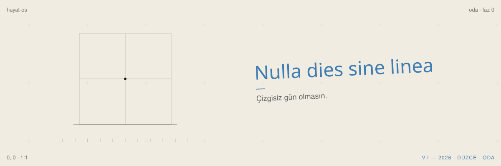
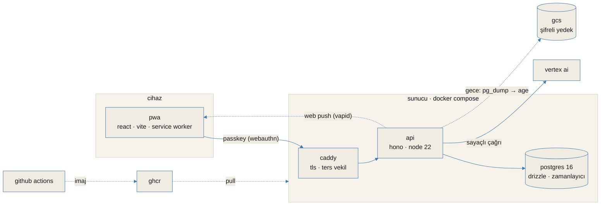

<p align="center"></p>

# Oda

(kod adi: hayat-os) Tek kullanicilik kisisel hayat isletim sistemi. Anayasa: `docs/anayasa/`. Kararlar: `docs/kararlar.md`.

**Faz 0 = iskelet:** kimlik (WebAuthn), bildirim (Web Push), gece yedegi (GCS), sayacli AI altyapisi,
Postgres zamanlayici, PWA kabugu (Gece Matbaasi tasarim sistemi). Akilli ozellik yok (Faz 1+).

## Mimari



Belgelerin haritasi: [`docs/README.md`](docs/README.md).

## Yigin
- Monorepo (pnpm), TypeScript uctan uca. Backend: **Hono** + Node 22. DB: **Postgres 16 + Drizzle**.
- PWA: **React + Vite + Tailwind** (koyu tema, `docs/gorsel-kimlik.md`).
- Sifreleme: AES-256-GCM (Node yerlesik; neden libsodium degil: `docs/kararlar.md`). Yedek: `pg_dump` + **age** -> GCS.
- AI: **Vertex AI** (saglayici soyutlamasi arkasinda). Sayacsiz cagri tip duzeyinde imkansiz.

## Kararlar (ozet)
Sunucu us-central1 e2-micro (free) · Gemini=Vertex AI · OAuth=Production · Faz 0 LOKAL (localhost) ·
Build VM'de YOK (CI->GHCR). Ayrinti: `docs/kararlar.md`.

---

## A) Lokal kurulum (Faz 0 — simdi)

Gereken: Windows + Docker Desktop, Node 22+, pnpm.

### 1. Anahtarlari uret ve .env'i doldur
```bash
cp .env.example .env
# SODIUM_MASTER_KEY (32 bayt base64):
openssl rand -base64 32
# SETUP_TOKEN:
openssl rand -hex 32
# VAPID cifti:
npx web-push generate-vapid-keys
# BACKUP_AGE_KEY (public recipient) + private (parola kasasina):
#   age-keygen  ->  "Public key: age1..."  (public'i BACKUP_AGE_KEY'e yaz)
```
`.env`'e ekle: `DOMAIN=localhost`, `GCS_BACKUP_BUCKET=<gercek-bucket>`, `GCP_PROJECT_ID=<proje>`.
GCP service account json'ini `infra/secrets/gcp-sa.json` olarak koy (yedek + Vertex health icin).
> Yoksa: uygulama yine kalkar; Vertex health "kimlik yok" der, yedek "yapilandirma eksik" der.

### 2. Bagimliliklari kur + migration uret
```bash
pnpm install
pnpm --filter @hayatos/api db:generate   # migrations/ olusur (offline, DB gerekmez)
```

### 3a. Hizli gelistirme (onerilen)
```bash
docker compose -f infra/docker-compose.yml up -d db   # sadece Postgres
pnpm --filter @hayatos/api dev                          # API :3000 (migrate + poller)
pnpm --filter @hayatos/pwa dev                          # PWA :5173 (/api proxy)
```
Tarayici: `http://localhost:5173` -> kurulum anahtari ile passkey kaydi.

### 3b. Prod-benzeri (tam compose, lokal build)
```bash
cd infra && docker compose up --build      # db + api + caddy (http://localhost)
```
`docker-compose.override.yml` imajlari lokalde build eder. Tarayici: `http://localhost`.

### Faz 0 kabul kaniti (hepsi yesil)
1. `docker compose up` -> migrate kosar, servisler ayakta.
2. localhost -> setup token ile WebAuthn kayit -> passkey ile giris. Kayit ucu sonra kapali.
3. "Yedek al" -> gercek GCS bucket'inda `backup-*.tar.age` gorunur; indirilip acilir:
   ```bash
   gcloud storage cp gs://$GCS_BACKUP_BUCKET/backup-XXX.tar.age .
   age -d -i age-key.txt backup-XXX.tar.age | tar -xf -   # db.pgc cikar
   ```
4. `GET /api/ai/health` -> `ai_calls` tablosuna satir (sayacsiz cagri derlenmez).
5. "Test bildirimi" -> dev cihazinda push (cift-cihaz domain gununde).
6. `pnpm -r test` yesil.

---

## B) Domain gunu kontrol listesi (Faz 0 sonrasi — ertelendi)
1. GCP `us-central1` e2-micro olustur, statik IP, **1GB swap**, **butce alarmi** (aylik + %50/%90,
   ekran goruntusu `docs/runbook-log.md`'ye).
2. **Domain satin al -> DNS A kaydi VM statik IP'ye** (DNS yayilmadan TLS yok).
3. GitHub'a push -> CI imajlari GHCR'a koyar. VM'de:
   `docker login ghcr.io` -> `docker compose pull && docker compose up -d` (VM build ETMEZ).
   Not: `infra/docker-compose.yml` icinde `OWNER` -> GitHub kullanici adinla degistir.
4. `https://<DOMAIN>` yesil -> **production'da TEMIZ passkey kaydi** (localhost passkey'leri TASINMAZ,
   rpID farkli).
5. **Google OAuth redirect URI** `https://DOMAIN/api/oauth/google/callback` -> consent **Production**.
6. Cift-cihaz push testi (tablet + telefon).
7. GCS lifecycle: `gcloud storage buckets update gs://$GCS_BACKUP_BUCKET --lifecycle-file=infra/backup/lifecycle.json`
   (30 gun sil; aylik 12 ay retention ayri prefix ile domain gununde eklenir).

## Goc Plani (Oracle dersi)
Herhangi bir Ubuntu makinesinde: Docker kur -> repo klonla -> `.env`'i parola kasasindan geri koy
(**SODIUM_MASTER_KEY** ve **age private** olmadan dosyalar ACILMAZ — anahtar yedegi 1. madde) ->
`docker compose pull && up` -> son yedegi restore -> DNS'i yeni IP'ye -> OAuth redirect/webhook guncelle.

## Komutlar
```bash
pnpm -r test         # tum testler
pnpm -r typecheck    # tip kontrolu
pnpm -r build        # (typecheck; runtime tsx ile source'tan kosar)
```

Lisans: Apache-2.0 (bkz. [LICENSE](LICENSE)). Guvenlik: [SECURITY.md](SECURITY.md). Katki: [CONTRIBUTING.md](CONTRIBUTING.md).

---

**in short (english).** oda (codename hayat-os) is a single-user personal life os.
a typescript monorepo (pnpm): hono + node 22 api, postgres 16 + drizzle, a react + vite pwa,
webauthn passkeys, web push, aes-256-gcm encryption, age-encrypted nightly backups to gcs and a metered ai layer on vertex ai.
phase 0 is the skeleton; smart features come later. licensed under apache-2.0.
